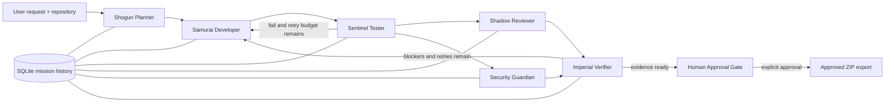

# DevPilot

## The Mystic Mikado's Autonomous AI Engineering Guild

**Plan like a Shogun. Build like a Samurai. Test like a Sentinel.**

DevPilot is a full-stack AI coding workspace with two modes: **Code Studio** converts a plain-language prompt into complete source files that can be viewed, copied, and downloaded; **Mission Mode** accepts a natural-language change request for an existing repository and runs it through a six-agent workflow: planning, implementation, testing, independent code review, security review, and evidence verification. Agent handoffs are recorded in a message-bus event stream, mission state is shared through LangGraph, history is persisted in SQLite, and a separate human approval action is required before changed files can be exported.

> **Operational note:** This repository is a runnable local-first engineering platform and reference implementation. Before exposing it to untrusted users or repositories, add authentication/authorization, run workers in a hardened container or VM, and use a real OS-level sandbox for project code execution. Repository test scripts are untrusted code and are disabled by default.

## Features

- Japanese shogun / cyberpunk command-center UI with dark glass cards, neon accents, animated particles, and Framer Motion transitions.
- Next.js 15 App Router, TypeScript, Tailwind CSS, shadcn-style component primitives, and React Flow architecture visualization.
- LangGraph state machine for six specialists, parallel review/security execution, conditional retry routing, and a maximum of five implementation passes.
- Prompt-to-code generation in Code Studio, with file tabs, copy/download controls, run instructions, and OpenAI/Gemini model adapters.
- OpenAI Responses API and Google Gemini provider adapters, plus a no-credential mock mode.
- Shared `MissionMemory` with objectives, criteria, task ledger, event findings, test results, reviews, security results, current status, and iteration count.
- Safe repository-folder upload with path normalization, generated-directory filtering, limits, and app-managed storage.
- Repository scanner for framework, language, package manager, entry points, tests, important files, and filename-based risk areas.
- Restricted file reader/editor, symlink checks, protected files, command allowlist, static syntax checks, and a static security scanner.
- NDJSON live activity stream, agent timeline, tool invocation panel, persistent mission history, SQLite analytics, human approval, and ZIP export of approved changed files.
- Jest tests for path/command guards, repository scanning, and Code Studio output validation.

## Code Studio: prompt to code

Open `/studio` or choose **Code Studio** in the navigation. Enter a plain-language request (for example, "Create a responsive login page with email and password fields"), select a preferred stack or leave it on auto-detect, and click **Generate code**. The result includes one or more source files, a short summary, optional run instructions, and implementation notes. Select a file tab to inspect the code, copy it, or download that file. Download all generated files together as a ZIP, including a `DEVPILOT-NOTES.md` with instructions and assumptions.

`POST /api/code/generate` calls the configured OpenAI or Gemini provider and validates the response before returning it. `POST /api/code/export` validates the returned file set again and packages the source files into a ZIP. Generated code is displayed only: Code Studio does not write it into a repository, execute it, or claim it has been tested. Use Mission Mode when you want DevPilot to stage changes in an uploaded repository and run its review/verification workflow.

Code Studio requires a configured provider. In `.env.local`, set `DEVPILOT_MODEL_PROVIDER=openai` with `OPENAI_API_KEY`, or `DEVPILOT_MODEL_PROVIDER=gemini` with `GEMINI_API_KEY`. Mock mode is intentionally not presented as real code generation.

## Architecture



### Agent responsibilities

| Agent | Responsibility | Output |
|---|---|---|
| **Shogun Planner** | Interprets the user request, reviews repository metadata, decomposes work, and delegates tasks. | Objectives, acceptance criteria, task ledger |
| **Samurai Developer** | Selects relevant files, reads bounded source context, proposes complete file edits, and writes changes through the guarded editor. | Staged source changes |
| **Sentinel Tester** | Runs source syntax inspection; optionally runs the repository's npm test command when an operator enables execution in an isolated sandbox. | Test results and diagnostic evidence |
| **Shadow Reviewer** | Independently assesses correctness, readability, maintainability, and regression risk. | Review issues and status |
| **Security Guardian** | Scans source for common hard-coded secrets, dynamic code execution, process-execution primitives, and possible SQL injection patterns. | Security findings and status |
| **Imperial Verifier** | Combines implementation evidence, test result, review, and security findings; chooses retry, block, or approval-ready status. | Verification summary and routing decision |

The reviewer and security nodes fan out in parallel after the test gate. The verifier is a LangGraph fan-in barrier and will not run until both branches have returned.

## Shared memory and the message bus

The TypeScript `MissionMemory` shape is defined in `src/lib/types.ts`:

```ts
interface MissionMemory {
  request: string;
  objectives: string[];
  criteria: string[];
  tasks: Task[];
  completedTasks: string[];
  findings: AgentEvent[];
  reviews: ReviewResult;
  testResults: TestResult;
  securityResults: SecurityResult;
  status: MissionStatus;
  currentIteration: number;
  maxIterations: number;
  verifierSummary: string;
}
```

All LangGraph nodes receive the same graph state and return partial state updates. The workflow emits structured events containing `id`, `timestamp`, `agent`, `action`, `message`, `level`, and optional `iteration`. The API streams these as newline-delimited JSON so the browser can display activity while the graph executes. The latest mission payload and event history are written to SQLite during execution, then finalized after the graph reaches approval-ready, blocked, or failed status.

The current persistence layer stores durable mission records in SQLite. LangGraph checkpoint/replay persistence is not enabled yet; recovery from process termination during an active workflow is therefore limited to the saved mission record and its last emitted events.

## Feedback loops

1. Developer creates or updates a patch in the mission workspace.
2. Tester inspects changed source files and, when explicitly enabled, executes supported repository tests.
3. A failed test routes straight back to the developer while the five-pass budget remains.
4. Passing/skipped tests fan out to the independent reviewer and security scanner.
5. Blocking review/security results route back to the developer. The tester and both reviewers rerun after the fix.
6. At the retry limit, unresolved blockers become `blocked`. The workflow never self-approves.

A skipped test result is shown as a warning, not represented as a passed test. A human can approve an approval-ready change with skipped tests only after inspecting that evidence gap in the UI.

## Repository analysis

The browser's folder input submits relative paths and file bytes to `POST /api/repositories/upload`. The server creates a UUID-scoped managed copy under `.devpilot-data/repositories/`, excludes generated/dependency directories and secret-like files, and creates a repository record. `scanRepository()` inspects the uploaded files and identifies framework, languages, package manager, entry points, test files, important config/metadata, risk-area filenames, total size, and a bounded path tree.

Each mission gets a separate copy under `.devpilot-data/workspaces/<mission-id>/`. The original uploaded copy is not modified by the developer agent. The export route includes only files whose content differs from the original uploaded repository.

## Security boundaries

Implemented controls include:

- Uploaded file paths must be relative; absolute paths, drive paths, null bytes, `.` / `..` traversal, and duplicates are rejected.
- Upload counts, individual file sizes, total repository size, file-read size, and recursion depth are bounded.
- `.git`, `node_modules`, `.next`, build outputs, cache directories, `.env*`, `.npmrc`, `.pypirc`, credential files, private-key formats (`.pem`, `.key`, `.p12`, `.pfx`, `.ppk`, `.jks`, `.keystore`), and secret directories are not imported into the managed repository.
- Repository IDs must be UUIDs and all selected repository roots must live under the managed storage directory.
- File tools reject symlink traversal and enforce a root-relative path boundary.
- Autonomous edits cannot modify package manifests, lockfiles, `.gitignore`, build/TypeScript configuration, shell scripts, CI workflow paths, or environment files.
- Delete operations are not exposed to agents.
- Terminal command validation rejects shell operators, command chaining, privilege escalation, common destructive commands, shell interpreters, and network utilities. The only exposed process command is the explicit `npm test -- --runInBand` runner.
- Test/build execution is **off by default**. JavaScript project tests can run arbitrary code even when invoked through an allowlisted command, so enable tests only inside a hardened container/VM configured with no network, limited filesystem mounts, memory/CPU/PID limits, and a low-privilege user.
- Security findings are evidence-based static signals, not a proof of vulnerability absence.

### Important limits

The command validator is application-level defense in depth, not a complete operating-system sandbox. It cannot stop a project test script from using Node APIs to access the network or filesystem when test execution is enabled. Do not set `DEVPILOT_ENABLE_TEST_EXECUTION=true` in a normal developer session with untrusted repositories. Run DevPilot behind authentication and in a dedicated container/VM before serving multiple users. The sample has no user/tenant authorization layer.

## Human approval gate

The mission can reach `awaiting_approval` only after the verifier concludes there are no blocking test/review/security failures and at least one file changed. The UI summarizes changed files, tests, security, review, and verifier evidence. `POST /api/missions/:id/approve` validates the transition and records a separate human approval event. Only a completed, approved mission can use `GET /api/missions/:id/export` to download a ZIP containing changed files.

**Approval exports an artifact; it does not deploy code to the user's original computer or production infrastructure.** Applying the patch to a real repository and deploying it are intentionally outside the current implementation.

## Technology stack

- **Frontend:** Next.js 15, React 19, TypeScript, Tailwind CSS, Framer Motion, shadcn-style primitives, Lucide icons.
- **Architecture visualization:** React Flow (`@xyflow/react`).
- **Workflow:** LangGraph JS (`@langchain/langgraph`).
- **Models:** OpenAI Node SDK Responses API or Google Gen AI SDK (`@google/genai`).
- **Persistence:** SQLite through `better-sqlite3`.
- **Tests:** Jest + ts-jest.

## Setup

### Requirements

- Node.js 22 or later recommended.
- npm.
- An OpenAI or Gemini API key for Code Studio and model-backed Mission Mode implementation. Without a key, the application remains usable for UI navigation and mock mission planning, but Code Studio returns a clear configuration error instead of pretending to generate code.
- Optional: a dedicated isolated execution environment if you intend to enable repository test execution.

### 1. Install

The dependency versions intentionally align LangGraph and OpenAI on Zod 3.25.76. If you previously attempted an install with an older `package.json`, remove the old install artifacts before reinstalling.

PowerShell (Windows):

```powershell
Remove-Item -Recurse -Force node_modules -ErrorAction SilentlyContinue
Remove-Item -Force package-lock.json -ErrorAction SilentlyContinue
npm install
```

The project requires Node.js 22 or later (`node -v`).

### 2. Configure environment

Copy `.env.example` to `.env.local` and set one provider:

```dotenv
DEVPILOT_MODEL_PROVIDER=openai
OPENAI_API_KEY=your_key_here
OPENAI_MODEL=gpt-4.1-mini
DEVPILOT_DATA_DIR=.devpilot-data
DEVPILOT_ENABLE_TEST_EXECUTION=false
```

Or use Gemini:

```dotenv
DEVPILOT_MODEL_PROVIDER=gemini
GEMINI_API_KEY=your_key_here
GEMINI_MODEL=gemini-2.5-flash
```

Only the selected provider's server-side key is used. Never prefix API keys with `NEXT_PUBLIC_` or commit `.env.local`. API keys are not required for UI navigation and mock workflow testing.

### 3. Start the web app

```bash
npm run dev
```

Open `http://localhost:3000`.

### 4. Run type checks and tests

```bash
npm run typecheck
npm test
npm run lint
npm run build
```

If your deployment process must execute project tests, first provision a controlled sandbox with network access disabled and explicit CPU, memory, PID, and filesystem limits. Only inside that environment should you set `DEVPILOT_ENABLE_TEST_EXECUTION=true` and restart DevPilot.

## API routes

| Route | Purpose |
|---|---|
| `POST /api/code/generate` | Generate validated source files from a natural-language prompt (OpenAI/Gemini required) |
| `POST /api/code/export` | Validate and download generated source files as a ZIP |
| `POST /api/repositories/upload` | Upload a repository folder and receive its first analysis |
| `GET /api/repositories` | List recently uploaded repositories |
| `POST /api/repositories/:id/analyze` | Re-run repository analysis |
| `GET /api/missions` | Read mission history and analytics |
| `POST /api/missions` | Start a workflow; responds as NDJSON events followed by the result |
| `GET /api/missions/:id` | Read a complete mission record |
| `POST /api/missions/:id/approve` | Record explicit human approval |
| `GET /api/missions/:id/export` | Download an approved mission's changed files as ZIP |
| `GET /api/analytics` | Read persisted mission analytics |

## Project structure

```text
src/
  app/
    api/
      code/generate/route.ts
      code/export/route.ts
      analytics/route.ts
      repositories/{route.ts, upload/route.ts, [id]/analyze/route.ts}
      missions/route.ts
      missions/[id]/route.ts
      missions/[id]/approve/route.ts
      missions/[id]/export/route.ts
    architecture/page.tsx
    dashboard/page.tsx
    studio/page.tsx
    globals.css
    layout.tsx
    page.tsx
  components/
    architecture-flow.tsx
    code-generator.tsx
    mission-console.tsx
    top-nav.tsx
    ui/{badge,button,card}.tsx
  lib/
    agents/{plan,develop,workflow}.ts
    api/public.ts
    config.ts
    db/database.ts
    repository/{scan,workspace}.ts
    security/{path-guard,terminal-middleware}.ts
    services/{code-generation,file-tools,llm,mission-memory,reviewer,security-scanner,test-runner}.ts
    types.ts
    utils/cn.ts
tests/
  path-guard.test.ts
  repository-scan.test.ts
  code-generation.test.ts
```

## Known limitations

- No authentication, authorization, tenant isolation, SSO, or rate limiting is included. Do not expose the model-backed generation endpoints publicly without request quotas and abuse protection. Treat this as a local-first deployment until those controls are added.
- The application is designed for local-first operation. Shared/public hosting requires additional threat modeling and sandboxing.
- LangGraph checkpoint/replay recovery is not turned on; the database stores mission history and emitted events, but does not automatically resume a graph after an abrupt process loss.
- Repository testing is intentionally conservative. By default, source syntax is inspected but arbitrary project tests are not executed.
- Static security patterns are heuristics and can have false positives or miss vulnerabilities.
- The developer agent is constrained from editing manifests and shell/config files; adding dependencies or changing build tooling is a manual maintainer action.
- Large or binary assets may be omitted from model context and ZIP export; each file read/edit is bounded.
- The approval gate approves a downloadable patch artifact only. There is no GitHub PR creation, deployment pipeline, branch management, or remote repo connector in this version.
- Mock mode plans a mission but does not fabricate source edits or Code Studio output when no model provider is configured. Code Studio validates generated file paths and sizes, but generated code still requires human review before use.

## Future scope

- LangGraph SQLite checkpointer and resumable human interrupts.
- Container-backed worker pool with network-disabled execution and signed artifacts.
- Authentication, project roles, tenant-level storage boundaries, audit log retention, and rate limits.
- Git worktrees, patch generation, pull-request opening, and CI result ingestion.
- Deeper AST-aware edits, coverage analysis, mutation tests, dependency vulnerability scanning, and policy-as-code.
- Multiple model profiles and cost/latency telemetry, plus a single-agent baseline benchmark on the same repository fixtures.

## License

No license is specified. Add a license appropriate for your intended distribution before publishing the repository.
